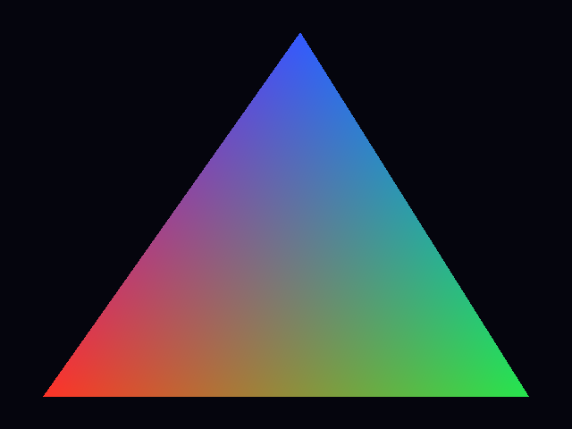
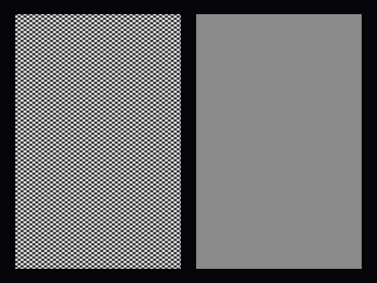

<p align="center">
  <a href="README.md"></a>
  <a href="README.zh-CN.md"></a>
</p>

# Glanceasy

A standalone, CPU-only implementation of OpenGL ES for ARM32 Cortex-A SoCs.

Glanceasy rasterises every draw call in software. It is derived from the Glanceasy
software painter that shipped inside the WebGlance browser prototype, but the
GLES front end has been rewritten from scratch: no GPU driver, no EGL, no
platform window system, and no x86-specific code. The library exposes the
Khronos GLES 2.0 and 3.0 entry points, keeps its own RGBA8 colour buffer, a
16-bit depth buffer and an 8-bit stencil buffer, and renders into memory that
the embedder can blit or upload wherever it likes.

The code and comments follow the Chromium C++ style, and all comments are in
English.

The reference target is the Rockchip RV1106, a single-core Cortex-A7 with NEON.
The screenshot below was rendered by the ARM32 build running under
`qemu-arm-static -cpu cortex-a7`:


## Visual test gallery

`tests/visual` contains fifteen rendering cases. Each case builds its own
program and vertex data through the public GLES API, renders a 640x480 frame,
checks a few pixels, and writes the frame to a PPM file. The images below are
the actual output of the ARM32 build executed under
`qemu-arm-static -cpu cortex-a7`; the interpreter and SLJIT backends agree with
the host build within one 8-bit LSB, which is the regression guarantee the
suite provides.

These fifteen cases are the complete visual set, one screenshot per case. The
API-level suite has 181 cases; many of them exercise state transitions, invalid
enums and error paths that never touch a framebuffer, so those are asserted in
code instead of captured as images.

| Case | Screenshot | What it exercises |
| --- | --- | --- |
| `01_gradient` |  | Full-screen triangle, interpolated vertex colours plus a fragment-shader vignette |
| `02_triangle` |  | Flat triangle from two client arrays, per-vertex RGB and barycentric interpolation |
| `03_indexed_quad` |  | `glDrawElements` with a 16-bit index buffer, two triangles forming one quad |
| `04_depth_test` |  | Near red triangle occludes the far blue triangle through the depth buffer |
| `05_alpha_blend` |  | Opaque blue base with a half-transparent red overlay, `GL_SRC_ALPHA`, `GL_ONE_MINUS_SRC_ALPHA` |
| `06_texture_nearest` |  | 8x8 checker texture magnified with `GL_NEAREST`, blocky texel edges |
| `07_texture_linear` |  | The same texture with `GL_LINEAR`, smooth bilinear ramp |
| `08_mipmap` |  | 256x256 checkerboard, LOD 0 on the left and LOD 3 on the right via `textureLod` |
| `09_culling` |  | Back-face culling: the red back face is discarded, only the green front face remains |
| `10_scissor` |  | Scissor rectangle restricts the blue clear to the centre of the red frame |
| `11_stencil` |  | Diamond stencil mask limits a gradient to the masked region |
| `12_instancing` |  | Nine quads in one `glDrawArraysInstanced` call with per-instance offset and colour |
| `13_framebuffer` |  | Offscreen framebuffer colour texture, then composited back to the screen |
| `14_glsl_pattern` |  | Procedural concentric rings evaluated entirely in the fragment shader |
| `15_perspective_cube` |  | Perspective-projected cube with per-face colours and depth testing |

Running the gallery on the host:

```sh
cmake --build build --target glanceasy_visual_tests
./build/glanceasy_visual_tests visual-out 640 480
```

The second argument is the output directory; one PPM per case is written there.

## Status

| Area | State |
| --- | --- |
| GLES 2.0 API | Complete: buffers, vertex arrays, textures, framebuffers, shaders, state, draws |
| GLES 3.0 API | Core subset: VAOs, instancing, primitive restart, queries, fences, sampler objects, blit, invalidate, uniform blocks, transform feedback, 4x MSAA, ETC2/EAC compressed textures and floating-point texture sampling |
| Uniform blocks | `layout(std140)` blocks with scalar, vector, matrix, array and structure members, optional instance names, per-program binding points and ranged `GL_UNIFORM_BUFFER` bindings |
| Transform feedback | Named feedback objects, interleaved and separate varyings, base and ranged `GL_TRANSFORM_FEEDBACK_BUFFER` bindings, begin/end/pause/resume, primitive queries and `glDrawTransformFeedback`. Varyings may be float, integer or unsigned integer scalars, vectors, matrices and whole arrays or array elements; instanced feedback draws are not implemented |
| GLSL | Interpreter and SLJIT tier for ES 1.00 / 3.00 shaders; unsupported constructs fall back per stage, see [docs/GLSL_SUBSET.md](docs/GLSL_SUBSET.md) |
| Shader math | Transcendental built-ins use minimax approximations; `sin` / `cos` evaluate four lanes at a time with NEON on ARMv7. Integer, depth, stencil and blend paths stay exact |
| Fixed-function SIMD | `dot` / `normalize`, colour/depth/stencil clear fills and same-size blit row copies use four-lane NEON on ARMv7; partial masks keep the scalar path |
| Multiple render targets | Up to four colour outputs through `layout(location = N)`, `gl_FragData[0..3]` or sequential `out` variables; `glDrawBuffers` selects the attachment for each output |
| Compute, SSBO, image load/store | Accepted stubs; report `GL_INVALID_OPERATION` where output would change |
| Tessellation / geometry shaders | Not part of GLES; entry points are stubs |
| Platform integration | None by design; the embedder owns the surface |

## Building on a desktop host

```sh
cmake -S . -B build -G Ninja -DCMAKE_BUILD_TYPE=Debug
cmake --build build
./build/glanceasy_unittests
```

The host build is the development configuration and is also used for the
AddressSanitizer and coverage runs:

```sh
cmake -S . -B build-asan -G Ninja -DCMAKE_BUILD_TYPE=Debug \
  -DCMAKE_CXX_FLAGS="-fsanitize=address,undefined -fno-omit-frame-pointer" \
  -DCMAKE_EXE_LINKER_FLAGS="-fsanitize=address,undefined"
cmake --build build-asan
./build-asan/glanceasy_unittests
```

The ARM32 target is validated on Linux with the Luckfox SDK toolchain and
qemu-user; it is not a Windows build target.

## Building for RV1106 with the Luckfox SDK

`tools/build_luckfox_arm.sh` uses the compiler shipped by the
[Luckfox Pico RV1106 SDK](https://wiki.luckfox.com/zh/Luckfox-Pico-RV1106/SDK).
Point `LUCKFOX_TOOLCHAIN` at the SDK toolchain directory, or set
`LUCKFOX_SDK` to the SDK root:

```sh
LUCKFOX_TOOLCHAIN=$HOME/luckfox-pico/tools/linux/toolchain/arm-rockchip830-linux-uclibcgnueabihf \
  tools/build_luckfox_arm.sh build-rv1106
```

The script uses `-mcpu=cortex-a7 -mfpu=neon-vfpv4 -mfloat-abi=hard` and links
statically against the SDK uClibc and libstdc++.

## Building for ARM32 with the Android NDK

`tools/build_android.sh` cross-compiles the library and the test binaries for
`armeabi-v7a` with NEON enabled and a static C++ runtime:

```sh
ANDROID_NDK_ROOT=$HOME/android-ndk-r27c tools/build_android.sh
```

The result is a statically linked `ELF 32-bit ARM EABI5` executable. The script
uses `-mcpu=cortex-a7 -mfpu=neon-vfpv4 -mfloat-abi=softfp`, which matches the
RV1106 core while staying valid on the wider ARMv7-A family. It does not rely on
any x86 SSE code.

## Running the ARM32 binary under QEMU

`tools/run_qemu_arm.sh` runs any ARM32 ELF with `qemu-arm-static -cpu cortex-a7`.
The Luckfox uClibc binaries need no patching. Android NDK bionic binaries need
a 32-byte aligned TLS segment, so pass `GLANCEASY_PATCH_TLS=1` for those:

```sh
tools/run_qemu_arm.sh build-rv1106/glanceasy_unittests
tools/run_qemu_arm.sh build-rv1106/glanceasy_visual_tests visual-out 640 480
```

`QEMU_ARM_STATIC` selects the emulator; otherwise `qemu-arm-static` is looked up
in `PATH`. A system-mode QEMU installation can boot a full ARM image, but the
user-mode emulator is what this suite is verified against.

## Rendering the demo

`examples/render_cube.cpp` draws a perspective-projected, depth-tested cube into
an offscreen buffer and writes a binary PPM file. It uses only the public API:

```sh
cmake --build build --target glanceasy_cube_demo
./build/glanceasy_cube_demo cube.ppm 800 600
tools/run_qemu_arm.sh build-rv1106/glanceasy_cube_demo cube.ppm 800 600
```

The second command is the one that produced `docs/screenshot.png`; it took about
eight seconds under qemu-user on the development machine, which says nothing
about native RV1106 performance.

## Testing and coverage

The unit tests are registered through a small in-tree harness
(`tests/glanceasy_test.h`) and cover the rasteriser, texture sampling, the GLSL
interpreter, every implemented GL entry point, the error paths of the state
machine and the compatibility stubs.

```sh
tools/coverage.sh build-cov
```

The script configures a gcov build, runs the tests, and prints per-file line
coverage into `build-cov/coverage/summary.txt`. The current tree executes 181
API tests with zero failed checks; `tools/coverage.sh` reports line coverage for
the host build. The uncovered remainder is dominated by defensive error
branches, unsupported-format rejection paths and the GPU-only stubs, which are
listed in the coverage summary rather than hidden.

The fifteen visual cases above are a second layer: they assert pixels and keep
the rendered frames as artefacts, so rasterisation regressions show up both as
a failing check and as a visibly changed image. They do not contribute to the
gcov figures, which measure the library through the API tests only.

## Khronos GLES 3.0 CTS test report

### Scope and environment

The complete `gles3-main` case list from Khronos VK-GL-CTS was executed against
the ARM32 build of Glanceasy.

| Item | Value |
| --- | --- |
| Target | ARM32 Cortex-A7 (Rockchip RV1106 class), NEON / VFPv4 |
| Emulator | QEMU system mode: `qemu-system-arm -M virt -cpu cortex-a7 -m 1024` |
| CTS | Khronos VK-GL-CTS `deqp-gles3`, FBO surface 256 x 256 |
| Driver build | Release (`-O3`), `-mcpu=cortex-a7 -mfpu=neon-vfpv4 -mfloat-abi=hard`, uClibc |
| Run window | 2026-11-26 11:42 to 2026-11-27 07:21 (UTC+8) |
| Driver options | default framebuffer exposed as FBO 0 (`GLANCEASY_FBO_SURFACE_AS_ZERO=1`); harness allowed to bind the default framebuffer |

The CTS harness carries a small local patch so that the default framebuffer is
addressed as FBO 0 (the surface FBO created by the harness is released after
creation, `getDefaultFramebuffer()` returns 0, and attach-to-default binds 0
first). The patch changes only how the harness binds the default framebuffer; it
does not change any test expectation.

Command used per shard:

```sh
deqp-gles3 \
  --deqp-caselist-file=/usr/share/deqp/gles3-main.txt \
  --deqp-archive-dir=/usr/share/deqp \
  --deqp-surface-type=fbo \
  --deqp-surface-width=256 \
  --deqp-surface-height=256 \
  --deqp-log-filename=/tmp/cts.qpa
```

### Result summary

| Result | Cases | Share |
| --- | ---: | ---: |
| Executed | 40,676 / 40,676 | 100% |
| Pass | 38,110 | 93.69% |
| Quality / compatibility warning | 176 | 0.43% |
| Fail | 0 | 0.00% |
| NotSupported | 2,390 | 5.88% |
| Pass including warnings | 38,286 | 94.12% |

All 14 shards exited with `DEQP_EXIT=0`. `NotSupported` is reported by dEQP when
a case requires a capability the implementation deliberately does not provide;
it is not a failure, but it is also not counted as a pass in the strict figure
above.

### Per-shard results

| Shard | Cases | Pass | Warning | NotSupported | Fail |
| --- | ---: | ---: | ---: | ---: | ---: |
| 01 | 2,906 | 2,722 | 15 | 169 | 0 |
| 02 | 2,906 | 2,731 | 11 | 164 | 0 |
| 03 | 2,906 | 2,727 | 11 | 168 | 0 |
| 04 | 2,906 | 2,728 | 13 | 165 | 0 |
| 05 | 2,906 | 2,719 | 14 | 173 | 0 |
| 06 | 2,906 | 2,725 | 14 | 167 | 0 |
| 07 | 2,905 | 2,722 | 12 | 171 | 0 |
| 08 | 2,905 | 2,720 | 10 | 175 | 0 |
| 09 | 2,905 | 2,716 | 13 | 176 | 0 |
| 10 | 2,905 | 2,717 | 13 | 175 | 0 |
| 11 | 2,905 | 2,720 | 13 | 172 | 0 |
| 12 | 2,905 | 2,716 | 12 | 177 | 0 |
| 13 | 2,905 | 2,724 | 12 | 169 | 0 |
| 14 | 2,905 | 2,723 | 13 | 169 | 0 |
| **Total** | **40,676** | **38,110** | **176** | **2,390** | **0** |

### Failures

None. No case printed a `Fail` result line in any of the 14 shard logs, and no
`negative_api.buffer.*` case failed (the three cases that failed in an earlier
ARM run were rebuilt and now pass).

### NotSupported breakdown

`NotSupported` cases are capability gaps, concentrated in a few areas:

| Group | Cases | Reason |
| --- | ---: | --- |
| `texture.wrap` | 1,044 | ASTC compressed texture wrap modes |
| `texture.compressed` | 266 | ASTC block decoding |
| `fbo.blit` | 218 | float / integer format blit conversions |
| `texture.vertex` | 174 | vertex texture fetch with mipmap / wrap combinations |
| `transform_feedback.array_element` | 108 | matrix varyings in feedback array elements |
| `fbo.render` | 89 | float / integer render targets |
| `fragment_out.array` | 84 | float render targets |
| `fragment_out.basic` | 84 | float render targets |
| `fbo.color` | 69 | float / integer colour attachments |
| `draw_buffers_indexed` | 76 | indexed draw buffer / blend state |
| 8-sample MSAA | 31 | more than four samples |
| `program_binary` | 14 | binary shader programs |
| Other | 133 | filtering, PBO renderbuffer, indexed state queries, misc. format limits |

### Warnings

The 176 warnings are quality or compatibility warnings that dEQP counts as
passing: `texture.shadow` 102 (depth-comparison precision), shader built-in
functions 52, texture mipmap 16, `flush_finish` 4, FBO completeness 2.

### Targeted regression groups

The default-framebuffer rework was also verified group by group:

| Group | Cases | Pass | Warning | NotSupported | Fail |
| --- | ---: | ---: | ---: | ---: | ---: |
| `fbo.*` | 2,006 | 1,585 | 2 | 419 | 0 |
| `negative_api.*` | 309 | 305 | 0 | 4 | 0 |

On the host build the API suite runs 181 cases with zero failed checks.

## Directory layout

```
include/GLES2, GLES3, KHR     Khronos headers (unmodified)
include/glanceasy/glanceasy.h              Public C API of the software renderer
src/                           Context, rasteriser, texture pipeline, draw pipeline
src/glanceasy_fastmath.*             Scalar shader math approximations
src/glanceasy_simd.*                 Four-lane dot/scale and bulk fill helpers
src/glsl/                      Lexer, parser and interpreter for the GLSL subset
src/glanceasy_api_*.cpp              GLES entry points
examples/                      Standalone rendering demo
tests/                         Unit tests and the test harness
tests/visual/                  Visual regression cases and the PPM writer
tools/                         Luckfox/NDK builds, QEMU runner, TLS patch, coverage
docs/                          GLSL subset, porting notes and rendered screenshots
```

## Using the library

```c
#include "glanceasy/glanceasy.h"

glanceasyCreateContext(320, 240);
/* Call the GLES entry points as usual.  Include GLES3/gl32.h first. */
glanceasyDestroyContext();
```

`include/glanceasy/glanceasy.h` also exposes `glanceasyGetPixels`, `glanceasyGetPixels32`,
`glanceasyGetStats` and `glanceasyGetDiagnostics` for embedders that need the rendered
image, draw statistics or the last shader log.

## Known limitations

- A fragment shader may write up to four colour outputs, at locations 0 to 3.
  More than four outputs, or two outputs at the same location, fail to link.
- `out`/`inout` parameters, function overloading and recursion are outside the
  interpreted GLSL subset.  Arrays, structures and arrays of structures inside
  uniform blocks are supported; local structure definitions are not.
- Structures and array elements in the interpreter use a separate aggregate
  value buffer; the SLJIT tier only compiles scalar, vector and matrix types and
  falls back to the interpreter for aggregates and unsigned integers.
- Transform feedback varyings are limited to float scalars and vectors, and
  instanced feedback draws are not implemented. When feedback is active without
  rasterizer discard, the vertex shader runs once for capture and again for
  rasterisation.
- MSAA uses up to four samples for renderbuffers and textures.  The default
  framebuffer remains single-sampled; `gl_SampleMask` output and
  `glMinSampleShading` are not implemented.
- Compressed textures are software-decoded ETC2/EAC blocks (ETC1-compatible RGB,
  ETC2 RGBA and R11/RG11 EAC).  ASTC, DXT and vendor formats remain unsupported.
  Floating-point textures are sampleable but not colour-renderable.
- Texture images are stored top-down; `v = 0` addresses the first stored row.
- `dFdx`, `dFdy` and `fwidth` return zero, and implicit LOD selection is not
  computed; `textureLod` selects mip levels explicitly.
- Line and point primitives that land exactly on the bottom or right viewport
  edge clip asymmetrically because NDC `y = -1` maps to `height`.
- `glGetTexImage` is not part of GLES and is not provided.

## License

BSD-3-Clause. See [LICENSE](LICENSE). Third-party code: SLJIT under `deps/sljit`, Simplified BSD License.
