<p align="center">
  <a href="README.md"></a>
  <a href="README.zh-CN.md"></a>
</p>

# ZCat-GLES

A standalone, CPU-only implementation of OpenGL ES for ARM32 Cortex-A SoCs.

ZCat-GLES rasterises every draw call in software. It is derived from the ZCat
software painter that shipped inside the WebGlance browser prototype, but the
GLES front end has been rewritten from scratch: no GPU driver, no EGL, no
platform window system, and no x86-specific code. The library exposes the
Khronos GLES 2.0 and 3.0 entry points, keeps its own RGBA8 colour buffer, a
16-bit depth buffer and an 8-bit stencil buffer, and renders into memory that
the embedder can blit or upload wherever it likes.

The code and comments follow the Chromium C++ style, and all comments are in
English.

The reference target is the Rockchip RV1106, a single-core Cortex-A7 with NEON.
The screenshot below was rendered by the ARM32 build running under
`qemu-arm-static -cpu cortex-a7`:

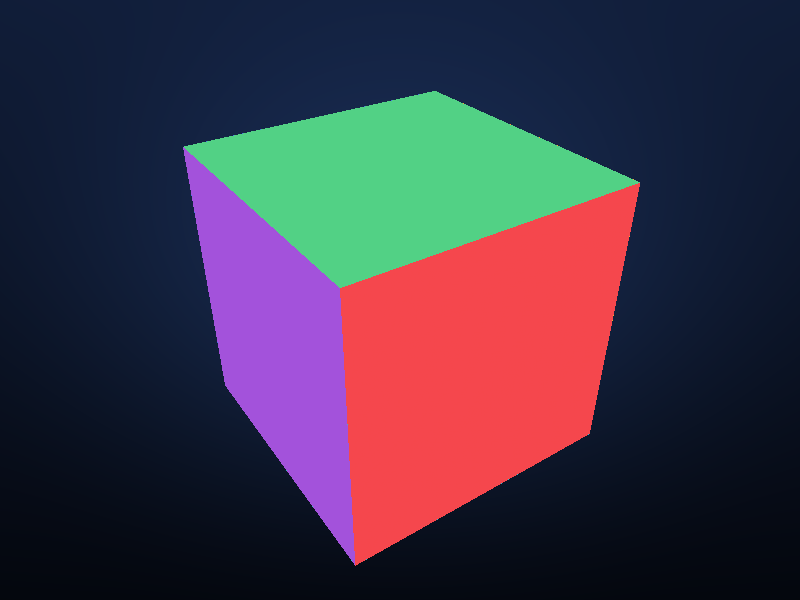

## Visual test gallery

`tests/visual` contains fifteen rendering cases. Each case builds its own
program and vertex data through the public GLES API, renders a 640x480 frame,
checks a few pixels, and writes the frame to a PPM file. The images below are
the actual output of the ARM32 build executed under
`qemu-arm-static -cpu cortex-a7`; every one of them is bit-identical to the
host build, which is the regression guarantee the suite provides.

These fifteen cases are the complete visual set, one screenshot per case. The
API-level suite has 148 cases; many of them exercise state transitions, invalid
enums and error paths that never touch a framebuffer, so those are asserted in
code instead of captured as images.

| Case | Screenshot | What it exercises |
| --- | --- | --- |
| `01_gradient` |  | Full-screen triangle, interpolated vertex colours plus a fragment-shader vignette |
| `02_triangle` |  | Flat triangle from two client arrays, per-vertex RGB and barycentric interpolation |
| `03_indexed_quad` | 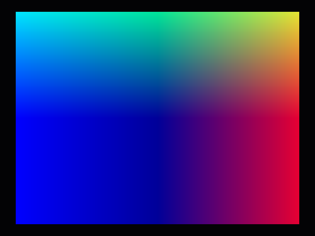 | `glDrawElements` with a 16-bit index buffer, two triangles forming one quad |
| `04_depth_test` | 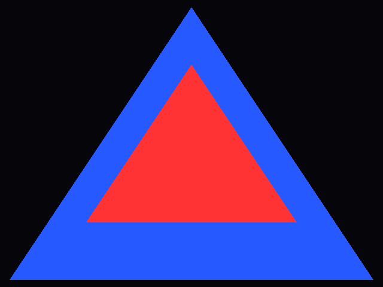 | Near red triangle occludes the far blue triangle through the depth buffer |
| `05_alpha_blend` | 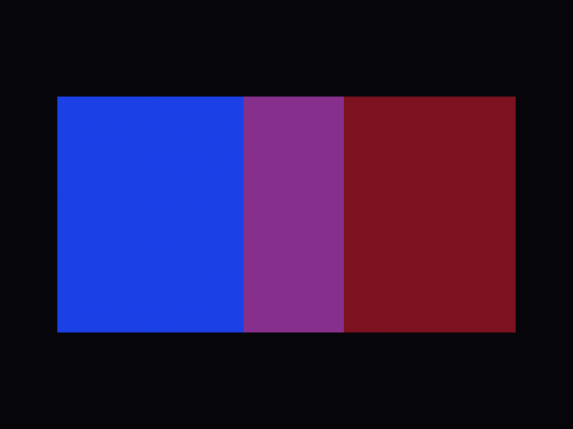 | Opaque blue base with a half-transparent red overlay, `GL_SRC_ALPHA`, `GL_ONE_MINUS_SRC_ALPHA` |
| `06_texture_nearest` | 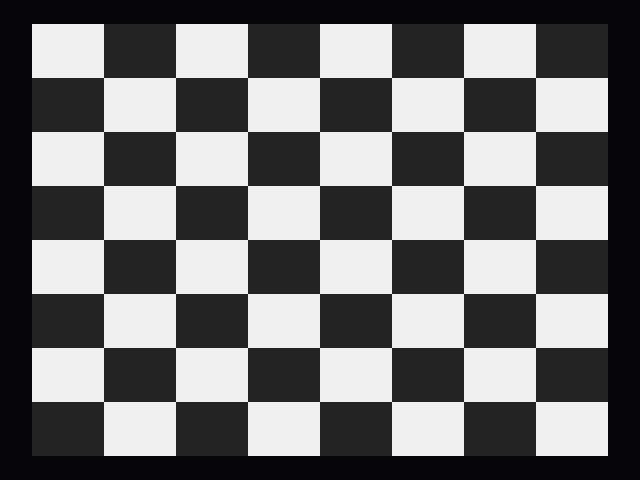 | 8x8 checker texture magnified with `GL_NEAREST`, blocky texel edges |
| `07_texture_linear` | 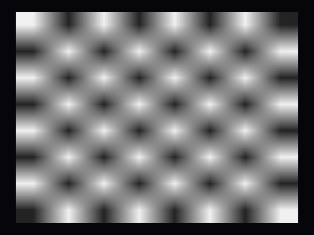 | The same texture with `GL_LINEAR`, smooth bilinear ramp |
| `08_mipmap` |  | 256x256 checkerboard, LOD 0 on the left and LOD 3 on the right via `textureLod` |
| `09_culling` | 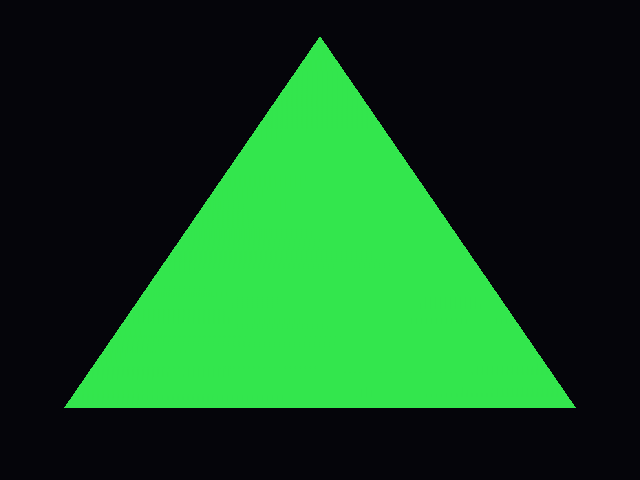 | Back-face culling: the red back face is discarded, only the green front face remains |
| `10_scissor` | 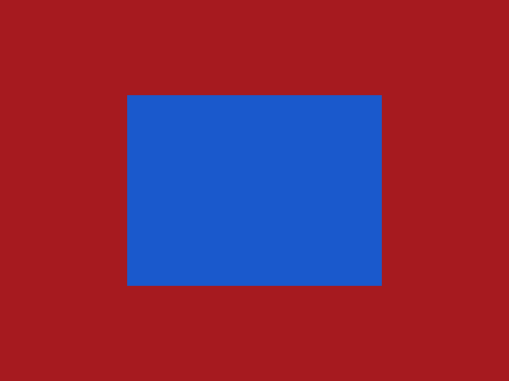 | Scissor rectangle restricts the blue clear to the centre of the red frame |
| `11_stencil` | 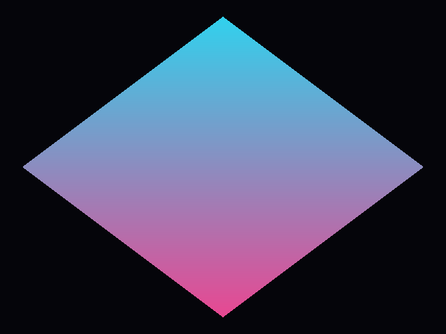 | Diamond stencil mask limits a gradient to the masked region |
| `12_instancing` | 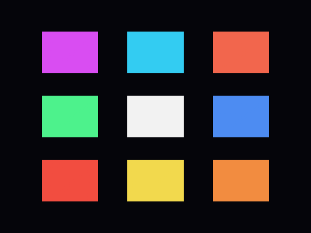 | Nine quads in one `glDrawArraysInstanced` call with per-instance offset and colour |
| `13_framebuffer` | 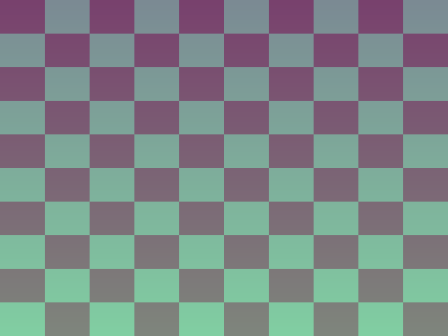 | Offscreen framebuffer colour texture, then composited back to the screen |
| `14_glsl_pattern` | 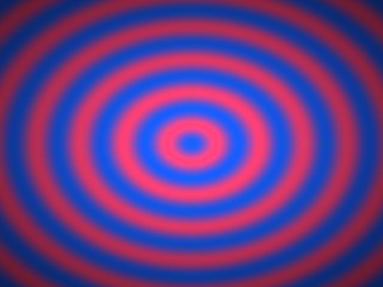 | Procedural concentric rings evaluated entirely in the fragment shader |
| `15_perspective_cube` | 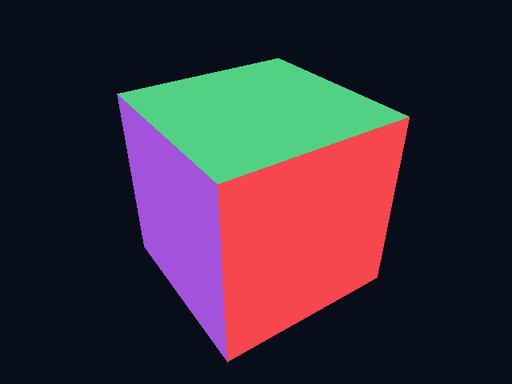 | Perspective-projected cube with per-face colours and depth testing |

Running the gallery on the host:

```sh
cmake --build build --target zgl_visual_tests
./build/zgl_visual_tests visual-out 640 480
```

The second argument is the output directory; one PPM per case is written there.

## Status

| Area | State |
| --- | --- |
| GLES 2.0 API | Complete: buffers, vertex arrays, textures, framebuffers, shaders, state, draws |
| GLES 3.0 API | Complete for the interpreted subset: VAOs, instancing, primitive restart, queries, fences, sampler objects, blit, invalidate |
| GLSL | Interpreter for ES 1.00 / 3.00 shaders, see [docs/GLSL_SUBSET.md](docs/GLSL_SUBSET.md) |
| Multiple render targets | One colour attachment is written; `gl_FragData[i]` and `out` variables beyond the first are rejected by the compiler |
| Transform feedback, compute, SSBO, image load/store | Accepted stubs; report `GL_INVALID_OPERATION` where output would change |
| Tessellation / geometry shaders | Not part of GLES; entry points are stubs |
| Platform integration | None by design; the embedder owns the surface |

## Building on a desktop host

```sh
cmake -S . -B build -G Ninja -DCMAKE_BUILD_TYPE=Debug
cmake --build build
./build/zgl_unittests
```

The host build is the development configuration and is also used for the
AddressSanitizer and coverage runs:

```sh
cmake -S . -B build-asan -G Ninja -DCMAKE_BUILD_TYPE=Debug \
  -DCMAKE_CXX_FLAGS="-fsanitize=address,undefined -fno-omit-frame-pointer" \
  -DCMAKE_EXE_LINKER_FLAGS="-fsanitize=address,undefined"
cmake --build build-asan
./build-asan/zgl_unittests
```

On Windows the repository is built from WSL; the Windows shell is only used to
launch `wsl.exe`.

## Building for ARM32 with the Android NDK

`tools/build_android.sh` cross-compiles the library and the test binaries for
`armeabi-v7a` with NEON enabled and a static C++ runtime:

```sh
ANDROID_NDK_ROOT=$HOME/android-ndk-r27c tools/build_android.sh
```

The result is a statically linked `ELF 32-bit ARM EABI5` executable. The script
uses `-mcpu=cortex-a7 -mfpu=neon-vfpv4 -mfloat-abi=softfp`, which matches the
RV1106 core while staying valid on the wider ARMv7-A family. It does not rely on
any x86 SSE code.

## Running the ARM32 binary under QEMU

Static bionic executables need a 32-byte aligned TLS segment; the NDK linker
does not always provide one, and bionic aborts at start-up under qemu-user.
`tools/run_qemu_arm.sh` patches the `PT_TLS` program header and then runs the
binary:

```sh
tools/run_qemu_arm.sh build-arm/zgl_unittests
tools/run_qemu_arm.sh build-arm/zgl_visual_tests visual-out 640 480
```

`QEMU_ARM_STATIC` selects the emulator (default `~/qemu-local/usr/bin/qemu-arm-static`).
A system-mode QEMU installation can also boot a full ARM image, but the
user-mode emulator is what the test suite is verified against.

## Rendering the demo

`examples/render_cube.cpp` draws a perspective-projected, depth-tested cube into
an offscreen buffer and writes a binary PPM file. It uses only the public API:

```sh
cmake --build build --target zgl_cube_demo
./build/zgl_cube_demo cube.ppm 800 600
tools/run_qemu_arm.sh build-arm/zgl_cube_demo cube.ppm 800 600
```

The second command is the one that produced `docs/screenshot.png`; it took about
eight seconds under qemu-user on the development machine, which says nothing
about native RV1106 performance.

## Testing and coverage

The unit tests are registered through a small in-tree harness
(`tests/zgl_test.h`) and cover the rasteriser, texture sampling, the GLSL
interpreter, every implemented GL entry point, the error paths of the state
machine and the compatibility stubs.

```sh
tools/coverage.sh build-cov
```

The script configures a gcov build, runs the tests, and prints per-file line
coverage into `build-cov/coverage/summary.txt`. The current tree executes 148
API tests with zero failed checks; line coverage is reported as 75.1% of 8590
instrumented lines. The uncovered remainder is dominated by defensive error
branches, unsupported-format rejection paths and the GPU-only stubs, which are
listed in the coverage summary rather than hidden.

The fifteen visual cases above are a second layer: they assert pixels and keep
the rendered frames as artefacts, so rasterisation regressions show up both as
a failing check and as a visibly changed image. They do not contribute to the
gcov figures, which measure the library through the API tests only.

## Directory layout

```
include/GLES2, include/GLES3   Khronos headers (unmodified)
include/zgl/zgl.h              Public C API of the software renderer
src/                           Context, rasteriser, texture pipeline, draw pipeline
src/glsl/                      Lexer, parser and interpreter for the GLSL subset
src/zgl_api_*.cpp              GLES entry points
examples/                      Standalone rendering demo
tests/                         Unit tests and the test harness
tests/visual/                  Visual regression cases and the PPM writer
tools/                         NDK build, QEMU runner, TLS patch, coverage
docs/                          GLSL subset, porting notes and rendered screenshots
```

## Using the library

```c
#include "zgl/zgl.h"

zglCreateContext(320, 240);
/* Call the GLES entry points as usual.  Include GLES3/gl32.h first. */
zglDestroyContext();
```

`include/zgl/zgl.h` also exposes `zglGetPixels`, `zglGetPixels32`,
`zglGetStats` and `zglGetDiagnostics` for embedders that need the rendered
image, draw statistics or the last shader log.

## Known limitations

- A fragment shader may write one colour output. `gl_FragData` is restricted to
  index 0, and additional `out` variables are rejected with a compile error.
- Arrays, structures, uniform blocks, `out`/`inout` parameters and recursive
  functions are outside the interpreted GLSL subset.
- Texture images are stored top-down; `v = 0` addresses the first stored row.
- `dFdx`, `dFdy` and `fwidth` return zero, and implicit LOD selection is not
  computed; `textureLod` selects mip levels explicitly.
- Line and point primitives that land exactly on the bottom or right viewport
  edge clip asymmetrically because NDC `y = -1` maps to `height`.
- `glGetTexImage` is not part of GLES and is not provided.

## License

BSD-3-Clause. See [LICENSE](LICENSE).
