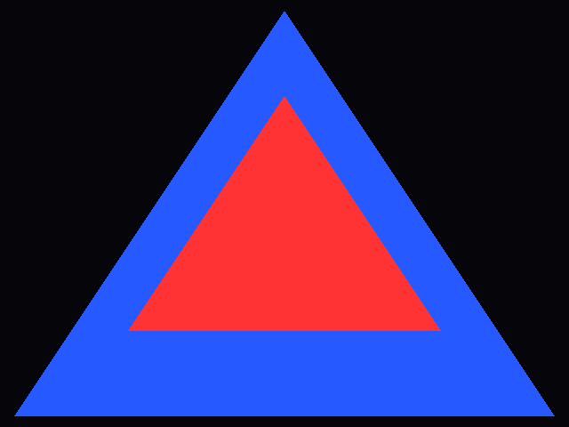
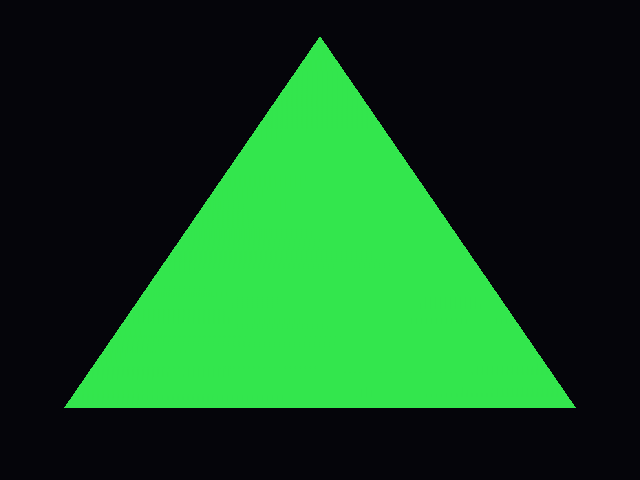
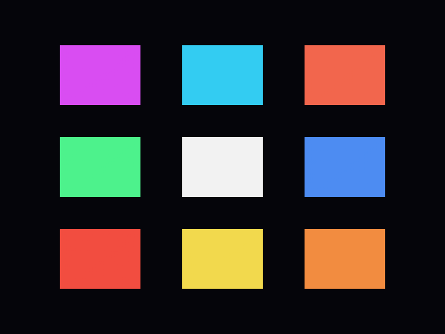
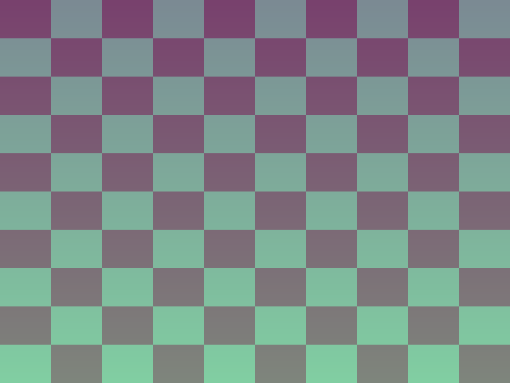

<p align="center">
  <a href="README.md"></a>
  <a href="README.zh-CN.md"></a>
</p>

# ZCat-GLES（中文）

一个独立的、纯 CPU 的 OpenGL ES 实现，面向 ARM32 Cortex-A SoC。

ZCat-GLES 的每一次绘制都在软件中完成光栅化。它源自 WebGlance 浏览器原型中的
ZCat 软件画家，但 GLES 前端是完全重写的：不依赖 GPU 驱动、不依赖 EGL、不依赖
平台窗口系统，也没有任何 x86 SSE 专用代码。库对外提供 Khronos GLES 2.0 / 3.0
入口，自带 RGBA8 颜色缓冲、16 位深度缓冲和 8 位模板缓冲，渲染结果留在内存中，
由集成方自行上屏或上传。

代码与注释遵循 Chromium C++ 风格，所有注释均为英文。

参考目标芯片是 Rockchip RV1106（单核 Cortex-A7，带 NEON）。下图由 ARM32 构建
在 `qemu-arm-static -cpu cortex-a7` 下实际渲染得到：


## 可视化测试图库

`tests/visual` 包含十五个渲染用例。每个用例都通过公开 GLES API 自建着色器和
顶点数据，渲染一帧 640x480 画面，校验少量像素，并把画面写成 PPM 文件。下面的
图片全部是 ARM32 构建在 `qemu-arm-static -cpu cortex-a7` 下的真实输出，并且
与宿主机构建逐像素一致，这正是该套件提供的回归保障。

| 用例 | 截图 | 覆盖内容 |
| --- | --- | --- |
| `01_gradient` |  | 全屏三角形，顶点色插值加片元着色器暗角 |
| `02_triangle` |  | 两个 client 数组构造平面三角形，逐顶点 RGB 与重心插值 |
| `03_indexed_quad` |  | `glDrawElements` 加 16 位索引缓冲，两个三角形拼成四边形 |
| `04_depth_test` |  | 近处红三角通过深度缓冲遮挡远处蓝三角 |
| `05_alpha_blend` |  | 不透明蓝色底层上叠加半透明红色覆盖层，`GL_SRC_ALPHA` / `GL_ONE_MINUS_SRC_ALPHA` |
| `06_texture_nearest` |  | 8x8 棋盘纹理以 `GL_NEAREST` 放大，保留方块状纹素边界 |
| `07_texture_linear` |  | 同一纹理改用 `GL_LINEAR`，呈现平滑的双线性过渡 |
| `08_mipmap` |  | 256x256 棋盘，左侧 `textureLod` 取 LOD 0，右侧取 LOD 3 |
| `09_culling` |  | 背面剔除：红色背面被丢弃，只剩绿色正面 |
| `10_scissor` |  | 裁剪矩形把蓝色限制在红色画面的中央区域 |
| `11_stencil` |  | 菱形模板遮罩把渐变限制在遮罩内部 |
| `12_instancing` |  | 一次 `glDrawArraysInstanced` 绘制九个四边形，逐实例偏移与颜色 |
| `13_framebuffer` |  | 离屏帧缓冲颜色纹理，再合成回屏幕 |
| `14_glsl_pattern` |  | 完全在片元着色器中计算的同心圆环 |
| `15_perspective_cube` |  | 透视投影立方体，逐面颜色加深测试 |

在宿主机上运行图库：

```sh
cmake --build build --target zgl_visual_tests
./build/zgl_visual_tests visual-out 640 480
```

第二个参数是输出目录，每个用例会在该目录写一个 PPM 文件。

## 状态

| 范围 | 状态 |
| --- | --- |
| GLES 2.0 API | 完整：缓冲、顶点数组、纹理、帧缓冲、着色器、状态、绘制 |
| GLES 3.0 API | 解释器子集内完整：VAO、instancing、primitive restart、query、fence、sampler object、blit、invalidate |
| GLSL | 支持 ES 1.00 / 3.00 着色器解释执行，见 [docs/GLSL_SUBSET.md](docs/GLSL_SUBSET.md) |
| 多重渲染目标 | 只写入一个颜色附件；`gl_FragData[i]` 与第一个之外的 `out` 变量会被编译器拒绝 |
| Transform feedback、compute、SSBO、image load/store | 纯桩；会影响输出的调用返回 `GL_INVALID_OPERATION` |
| 细分 / 几何着色器 | 不属于 GLES；入口为桩 |
| 平台集成 | 有意不做；表面归集成方所有 |

## 桌面宿主机编译

```sh
cmake -S . -B build -G Ninja -DCMAKE_BUILD_TYPE=Debug
cmake --build build
./build/zgl_unittests
```

宿主机构建是开发配置，也用于 AddressSanitizer 与覆盖率运行：

```sh
cmake -S . -B build-asan -G Ninja -DCMAKE_BUILD_TYPE=Debug \
  -DCMAKE_CXX_FLAGS="-fsanitize=address,undefined -fno-omit-frame-pointer" \
  -DCMAKE_EXE_LINKER_FLAGS="-fsanitize=address,undefined"
cmake --build build-asan
./build-asan/zgl_unittests
```

Windows 上请在 WSL 中执行上述命令，Windows 侧只用 `wsl.exe` 启动。

## 使用 Android NDK 交叉编译 ARM32

`tools/build_android.sh` 面向 `armeabi-v7a` 交叉编译库与测试程序，开启 NEON，
使用静态 C++ 运行库：

```sh
ANDROID_NDK_ROOT=$HOME/android-ndk-r27c tools/build_android.sh
```

产物是静态链接的 `ELF 32-bit ARM EABI5` 可执行文件。编译参数为
`-mcpu=cortex-a7 -mfpu=neon-vfpv4 -mfloat-abi=softfp`，与 RV1106 的 Cortex-A7
核心匹配，同时仍适用于整个 ARMv7-A 系列，不依赖任何 x86 SSE 代码。

## 在 QEMU 下运行 ARM32 产物

NDK 生成的静态 bionic 程序需要 32 字节对齐的 TLS 段，否则 bionic 在 qemu-user
下启动即中止。`tools/run_qemu_arm.sh` 会先修补 `PT_TLS` 程序头，再启动模拟器：

```sh
tools/run_qemu_arm.sh build-arm/zgl_unittests
tools/run_qemu_arm.sh build-arm/zgl_visual_tests visual-out 640 480
```

`QEMU_ARM_STATIC` 可指定模拟器路径，默认
`~/qemu-local/usr/bin/qemu-arm-static`。系统模式的 QEMU 也可以启动完整 ARM
镜像，但测试套件验证使用的是用户模式模拟器。

## 渲染示例

`examples/render_cube.cpp` 使用公开 API 绘制一个带透视投影和深度测试的立方体，
渲染到离屏缓冲后写出二进制 PPM 文件：

```sh
cmake --build build --target zgl_cube_demo
./build/zgl_cube_demo cube.ppm 800 600
tools/run_qemu_arm.sh build-arm/zgl_cube_demo cube.ppm 800 600
```

`docs/screenshot.png` 由第二条命令生成；在开发机上 qemu-user 耗时约 8 秒，这不
代表 RV1106 实机性能。

## 测试与覆盖率

单元测试通过仓库内的小型注册式框架（`tests/zgl_test.h`）组织，覆盖光栅化、
纹理采样、GLSL 解释器、全部已实现的 GL 入口、状态机错误路径以及兼容桩。

```sh
tools/coverage.sh build-cov
```

脚本会配置 gcov 构建、运行测试，并把逐文件行覆盖率写入
`build-cov/coverage/summary.txt`。当前共 148 个 API 测试、0 个失败断言；行覆盖率
为 8590 行中的 75.1%。未覆盖部分主要是防御性错误分支、不支持的格式拒绝路径
以及 GPU 专用桩，均如实列在覆盖率汇总中。

上面的十五个可视化用例是第二层验证：它们既校验像素，又把渲染结果作为产物保留，
因此光栅化回归既表现为断言失败，也表现为肉眼可见的画面变化。这些用例不计入
gcov 数字，覆盖率只统计通过 API 测试执行到的库代码。

## 目录结构

```
include/GLES2, include/GLES3   Khronos 原始头文件
include/zgl/zgl.h              软件渲染器的公共 C API
src/                           上下文、光栅化、纹理管线、绘制管线
src/glsl/                      GLSL 子集的词法、语法与解释执行
src/zgl_api_*.cpp              GLES 入口实现
examples/                      独立渲染示例
tests/                         单元测试与测试框架
tests/visual/                  可视化回归用例与 PPM 写出
tools/                         NDK 构建、QEMU 运行、TLS 修补、覆盖率
docs/                          GLSL 子集、移植说明与渲染截图
```

## 使用方式

```c
#include "zgl/zgl.h"

zglCreateContext(320, 240);
/* 之后正常调用 GLES 入口，需先包含 GLES3/gl32.h。 */
zglDestroyContext();
```

`include/zgl/zgl.h` 还提供 `zglGetPixels`、`zglGetPixels32`、`zglGetStats` 与
`zglGetDiagnostics`，供集成方取回渲染结果、绘制统计或最近的着色器日志。

## 已知限制

- 片元着色器只能写一个颜色输出；`gl_FragData` 仅允许下标 0，额外的 `out` 变量
  会被编译错误拒绝。
- 数组、结构体、uniform block、`out`/`inout` 参数、递归函数不在解释器子集内。
- 纹理图像按 top-down 存储，`v = 0` 对应第一条存储的行。
- `dFdx`、`dFdy`、`fwidth` 恒为 0，不计算隐式 LOD；`textureLod` 可显式选级。
- 恰好落在视口底边或右边的线与点会被非对称裁剪，因为 NDC 的 `y = -1` 映射到
  `height`。
- 不提供 `glGetTexImage`（它不属于 GLES）。

## 许可证

BSD-3-Clause，见 [LICENSE](LICENSE)。
