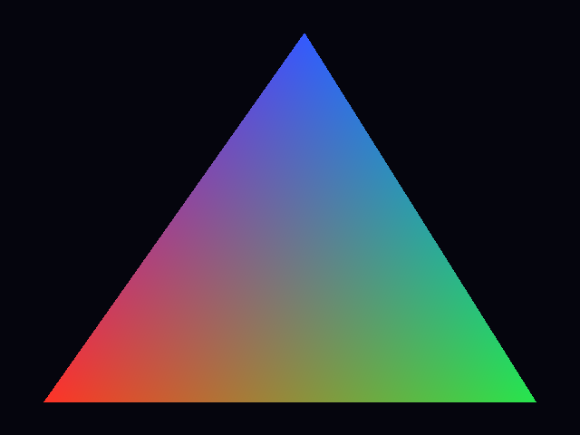
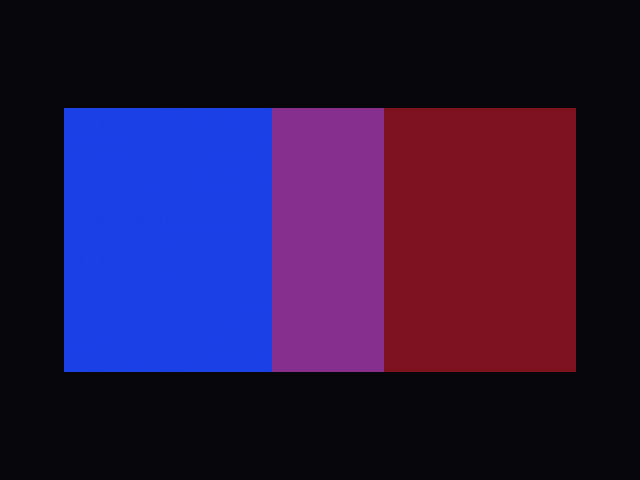
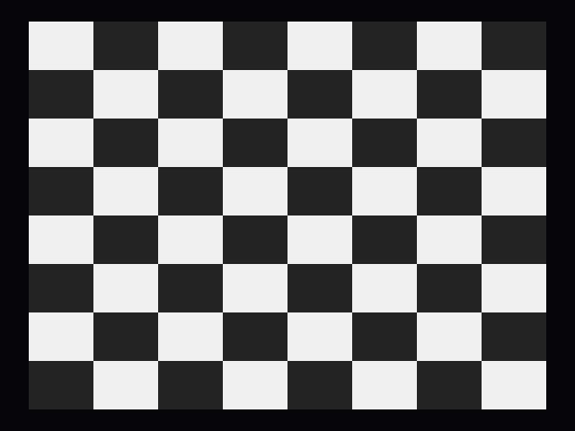
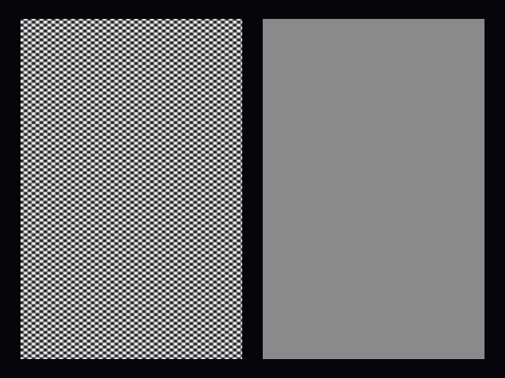
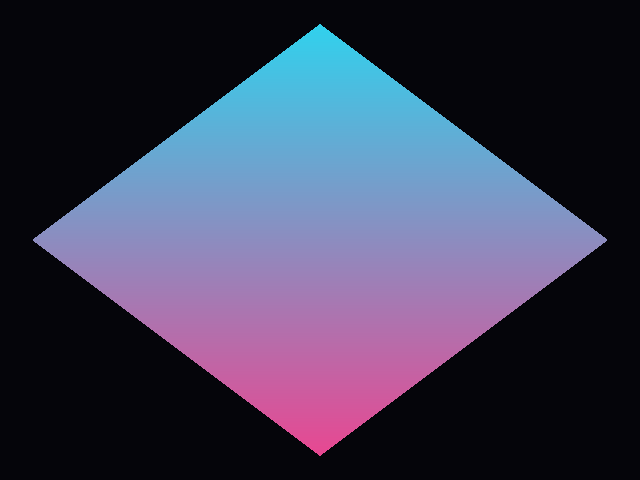

<p align="center">
  <a href="README.md"></a>
  <a href="README.zh-CN.md"></a>
</p>

# Glanceasy（中文）

一个独立的、纯 CPU 的 OpenGL ES 实现，面向 ARM32 Cortex-A SoC。

Glanceasy 的每一次绘制都在软件中完成光栅化。它源自 WebGlance 浏览器原型中的
Glanceasy 软件画家，但 GLES 前端是完全重写的：不依赖 GPU 驱动、不依赖平台窗口系统，
也没有任何 x86 SSE 专用代码。另有一个可选的 EGL 1.4 适配层，仅用于基准测试工具。
库对外提供 Khronos GLES 2.0 / 3.0 入口，自带 RGBA8 颜色缓冲、16 位深度缓冲和 8 位模板缓冲，渲染结果留在内存中，
由集成方自行上屏或上传。

代码与注释遵循 Chromium C++ 风格，所有注释均为英文。

参考目标芯片是 Rockchip RV1106（单核 Cortex-A7，带 NEON）。下图由 ARM32 构建
在 `qemu-arm-static -cpu cortex-a7` 下实际渲染得到：


## 可视化测试图库

`tests/visual` 包含十五个渲染用例。每个用例都通过公开 GLES API 自建着色器和
顶点数据，渲染一帧 640x480 画面，校验少量像素，并把画面写成 PPM 文件。下面的
图片全部是 ARM32 构建在 `qemu-arm-static -cpu cortex-a7` 下的真实输出；解释器
与 SLJIT 后端的输出相对宿主机构建均在 1 个 8 位 LSB 以内，这正是该套件提供的
回归保障。

这十五个用例构成完整的可视化集合，每个用例一张截图。API 层测试共 181 个，
其中不少只验证状态迁移、非法枚举和错误路径，根本不会触碰帧缓冲，因此这些
用例只用代码断言，不做截图。

| 用例 | 截图 | 覆盖内容 |
| --- | --- | --- |
| `01_gradient` |  | 全屏三角形，顶点色插值加片元着色器暗角 |
| `02_triangle` |  | 两个 client 数组构造平面三角形，逐顶点 RGB 与重心插值 |
| `03_indexed_quad` |  | `glDrawElements` 加 16 位索引缓冲，两个三角形拼成四边形 |
| `04_depth_test` |  | 近处红三角通过深度缓冲遮挡远处蓝三角 |
| `05_alpha_blend` |  | 不透明蓝色底层上叠加半透明红色覆盖层，`GL_SRC_ALPHA` / `GL_ONE_MINUS_SRC_ALPHA` |
| `06_texture_nearest` |  | 8x8 棋盘纹理以 `GL_NEAREST` 放大，保留方块状纹素边界 |
| `07_texture_linear` |  | 同一纹理改用 `GL_LINEAR`，呈现平滑的双线性过渡 |
| `08_mipmap` |  | 256x256 棋盘，左侧 `textureLod` 取 LOD 0，右侧取 LOD 3 |
| `09_culling` |  | 背面剔除：红色背面被丢弃，只剩绿色正面 |
| `10_scissor` |  | 裁剪矩形把蓝色限制在红色画面的中央区域 |
| `11_stencil` |  | 菱形模板遮罩把渐变限制在遮罩内部 |
| `12_instancing` |  | 一次 `glDrawArraysInstanced` 绘制九个四边形，逐实例偏移与颜色 |
| `13_framebuffer` |  | 离屏帧缓冲颜色纹理，再合成回屏幕 |
| `14_glsl_pattern` |  | 完全在片元着色器中计算的同心圆环 |
| `15_perspective_cube` |  | 透视投影立方体，逐面颜色加深测试 |

在宿主机上运行图库：

```sh
cmake --build build --target glanceasy_visual_tests
./build/glanceasy_visual_tests visual-out 640 480
```

第二个参数是输出目录，每个用例会在该目录写一个 PPM 文件。

## 状态

| 范围 | 状态 |
| --- | --- |
| GLES 2.0 API | 完整：缓冲、顶点数组、纹理、帧缓冲、着色器、状态、绘制 |
| GLES 3.0 API | 核心子集：VAO、instancing、primitive restart、query、fence、sampler object、blit、invalidate、uniform block、transform feedback、4x MSAA、ETC2/EAC 压缩纹理与浮点纹理采样 |
| Uniform block | `layout(std140)` 块，支持标量、向量、矩阵、数组与结构体成员，支持可选实例名、每程序 binding point 和带范围的 `GL_UNIFORM_BUFFER` 绑定 |
| Transform feedback | 命名的 feedback 对象、interleaved / separate varyings、`GL_TRANSFORM_FEEDBACK_BUFFER` 的 base / range 绑定、begin/end/pause/resume、primitive query 与 `glDrawTransformFeedback`。varying 支持浮点、整数、无符号整数标量/向量/矩阵以及整个数组或数组元素；尚不支持 instanced feedback 绘制 |
| GLSL | 支持 ES 1.00 / 3.00 的解释执行与 SLJIT 分层编译；不支持的构造按 stage 回退，见 [docs/GLSL_SUBSET.md](docs/GLSL_SUBSET.md) |
| 着色器数学 | 超越函数使用 minimax 近似；ARMv7 上 `sin` / `cos` 每次并行计算四个 lane（NEON）。整数、深度、模板与混合路径保持精确 |
| 固定功能 SIMD | `dot` / `normalize`、颜色/深度/模板的 clear 填充、同尺寸 blit 的行拷贝在 ARMv7 上走四 lane NEON；部分颜色掩码仍走标量路径 |
| 多重渲染目标 | 最多四个颜色输出，可用 `layout(location = N)`、`gl_FragData[0..3]` 或顺序 `out` 变量；`glDrawBuffers` 决定每个输出写到哪个附件 |
| compute、SSBO、image load/store | 纯桩；会影响输出的调用返回 `GL_INVALID_OPERATION` |
| 细分 / 几何着色器 | 不属于 GLES；入口为桩 |
| 平台集成 | 有意不做；表面归集成方所有 |

## 桌面宿主机编译

```sh
cmake -S . -B build -G Ninja -DCMAKE_BUILD_TYPE=Debug
cmake --build build
./build/glanceasy_unittests
```

宿主机构建是开发配置，也用于 AddressSanitizer 与覆盖率运行：

```sh
cmake -S . -B build-asan -G Ninja -DCMAKE_BUILD_TYPE=Debug \
  -DCMAKE_CXX_FLAGS="-fsanitize=address,undefined -fno-omit-frame-pointer" \
  -DCMAKE_EXE_LINKER_FLAGS="-fsanitize=address,undefined"
cmake --build build-asan
./build-asan/glanceasy_unittests
```

ARM32 目标在 Linux 上使用 Luckfox SDK 工具链与 qemu-user 验证，不以 Windows
作为构建或测试环境。

## 使用 Luckfox SDK 编译 RV1106 目标

`tools/build_luckfox_arm.sh` 使用
[Luckfox Pico RV1106 SDK](https://wiki.luckfox.com/zh/Luckfox-Pico-RV1106/SDK)
自带的交叉编译器。把 `LUCKFOX_TOOLCHAIN` 指向 SDK 工具链目录，或把
`LUCKFOX_SDK` 指向 SDK 根目录：

```sh
LUCKFOX_TOOLCHAIN=$HOME/luckfox-pico/tools/linux/toolchain/arm-rockchip830-linux-uclibcgnueabihf \
  tools/build_luckfox_arm.sh build-rv1106
```

脚本使用 `-mcpu=cortex-a7 -mfpu=neon-vfpv4 -mfloat-abi=hard`，并静态链接 SDK
的 uClibc 与 libstdc++。

## 使用 Android NDK 交叉编译 ARM32

`tools/build_android.sh` 面向 `armeabi-v7a` 交叉编译库与测试程序，开启 NEON，
使用静态 C++ 运行库：

```sh
ANDROID_NDK_ROOT=$HOME/android-ndk-r27c tools/build_android.sh
```

产物是静态链接的 `ELF 32-bit ARM EABI5` 可执行文件。编译参数为
`-mcpu=cortex-a7 -mfpu=neon-vfpv4 -mfloat-abi=softfp`，与 RV1106 的 Cortex-A7
核心匹配，同时仍适用于整个 ARMv7-A 系列，不依赖任何 x86 SSE 代码。

## 在 QEMU 下运行 ARM32 产物

`tools/run_qemu_arm.sh` 以 `qemu-arm-static -cpu cortex-a7` 运行任意 ARM32 ELF。
Luckfox 的 uClibc 产物无需修补；Android NDK 的 bionic 产物需要 32 字节对齐的
TLS 段，此时设置 `GLANCEASY_PATCH_TLS=1`：

```sh
tools/run_qemu_arm.sh build-rv1106/glanceasy_unittests
tools/run_qemu_arm.sh build-rv1106/glanceasy_visual_tests visual-out 640 480
```

`QEMU_ARM_STATIC` 可指定模拟器路径；未设置时从 `PATH` 中查找
`qemu-arm-static`。系统模式的 QEMU 也可以启动完整 ARM 镜像，但本套件验证使用
的是用户模式模拟器。

## glmark2 基准测试

配置 `GLANCEASY_BUILD_EGL=ON` 会额外生成最小 EGL 1.4 适配层和共享 GLES 库，
使通用 GLES 基准测试可以在离屏模式下运行。该适配层不是窗口系统后端，只实现
`glmark2-es2-null` 所需的 surfaceless/pbuffer 子集，并把 EGL 上下文映射到
Glanceasy 上下文。

```sh
cmake -S . -B build-egl -DCMAKE_BUILD_TYPE=Release -DGLANCEASY_BUILD_EGL=ON
cmake --build build-egl -j
```

glmark2 的构建、QEMU 运行命令、当前分数和注意事项见
[docs/BENCHMARK.md](docs/BENCHMARK.md)。

## 渲染示例

`examples/render_cube.cpp` 使用公开 API 绘制一个带透视投影和深度测试的立方体，
渲染到离屏缓冲后写出二进制 PPM 文件：

```sh
cmake --build build --target glanceasy_cube_demo
./build/glanceasy_cube_demo cube.ppm 800 600
tools/run_qemu_arm.sh build-rv1106/glanceasy_cube_demo cube.ppm 800 600
```

`docs/screenshot.png` 由第二条命令生成；在开发机上 qemu-user 耗时约 8 秒，这不
代表 RV1106 实机性能。

## 测试与覆盖率

单元测试通过仓库内的小型注册式框架（`tests/glanceasy_test.h`）组织，覆盖光栅化、
纹理采样、GLSL 解释器、全部已实现的 GL 入口、状态机错误路径以及兼容桩。

```sh
tools/coverage.sh build-cov
```

脚本会配置 gcov 构建、运行测试，并把逐文件行覆盖率写入
`build-cov/coverage/summary.txt`。当前共 181 个 API 测试、0 个失败断言；
`tools/coverage.sh` 会给出宿主机构建的行覆盖率。未覆盖部分主要是防御性错误
分支、不支持的格式拒绝路径以及 GPU 专用桩，均如实列在覆盖率汇总中。

上面的十五个可视化用例是第二层验证：它们既校验像素，又把渲染结果作为产物保留，
因此光栅化回归既表现为断言失败，也表现为肉眼可见的画面变化。这些用例不计入
gcov 数字，覆盖率只统计通过 API 测试执行到的库代码。

## Khronos GLES 3.0 CTS 测试报告

### 测试范围与环境

使用 Khronos VK-GL-CTS 的完整 `gles3-main` 用例列表，对 Glanceasy 的 ARM32
构建进行全量测试。

| 项目 | 内容 |
| --- | --- |
| 目标平台 | ARM32 Cortex-A7（瑞芯微 RV1106 级别），NEON / VFPv4 |
| 模拟器 | QEMU system 模式：`qemu-system-arm -M virt -cpu cortex-a7 -m 1024` |
| CTS | Khronos VK-GL-CTS `deqp-gles3`，FBO surface 256 x 256 |
| 驱动构建 | Release（`-O3`），`-mcpu=cortex-a7 -mfpu=neon-vfpv4 -mfloat-abi=hard`，uClibc |
| 运行时间 | 2026-11-26 11:42 至 2026-11-27 07:21（UTC+8） |
| 驱动选项 | 默认帧缓冲按 FBO 0 暴露（`GLANCEASY_FBO_SURFACE_AS_ZERO=1`），允许 harness 绑定默认帧缓冲 |

本地对 CTS harness 打了小补丁：harness 创建 surface FBO 后将其释放，
`getDefaultFramebuffer()` 返回 0，attach 到默认帧缓冲前先绑定 0。补丁只改变
harness 绑定默认帧缓冲的方式，不改变任何测试期望。

每个分片使用的命令：

```sh
deqp-gles3 \
  --deqp-caselist-file=/usr/share/deqp/gles3-main.txt \
  --deqp-archive-dir=/usr/share/deqp \
  --deqp-surface-type=fbo \
  --deqp-surface-width=256 \
  --deqp-surface-height=256 \
  --deqp-log-filename=/tmp/cts.qpa
```

### 结果总览

| 结果 | 用例数 | 占比 |
| --- | ---: | ---: |
| 实际执行 | 40,676 / 40,676 | 100% |
| Pass | 38,110 | 93.69% |
| Quality / Compatibility Warning | 176 | 0.43% |
| Fail | 0 | 0.00% |
| NotSupported | 2,390 | 5.88% |
| Pass（含 Warning） | 38,286 | 94.12% |

14 个分片全部以 `DEQP_EXIT=0` 退出。`NotSupported` 是 dEQP 在用例依赖实现
主动不提供的能力时给出的结果，不属于失败，但也不计入上面的严格 Pass 比例。

### 各分片结果

| 分片 | 用例数 | Pass | Warning | NotSupported | Fail |
| --- | ---: | ---: | ---: | ---: | ---: |
| 01 | 2,906 | 2,722 | 15 | 169 | 0 |
| 02 | 2,906 | 2,731 | 11 | 164 | 0 |
| 03 | 2,906 | 2,727 | 11 | 168 | 0 |
| 04 | 2,906 | 2,728 | 13 | 165 | 0 |
| 05 | 2,906 | 2,719 | 14 | 173 | 0 |
| 06 | 2,906 | 2,725 | 14 | 167 | 0 |
| 07 | 2,905 | 2,722 | 12 | 171 | 0 |
| 08 | 2,905 | 2,720 | 10 | 175 | 0 |
| 09 | 2,905 | 2,716 | 13 | 176 | 0 |
| 10 | 2,905 | 2,717 | 13 | 175 | 0 |
| 11 | 2,905 | 2,720 | 13 | 172 | 0 |
| 12 | 2,905 | 2,716 | 12 | 177 | 0 |
| 13 | 2,905 | 2,724 | 12 | 169 | 0 |
| 14 | 2,905 | 2,723 | 13 | 169 | 0 |
| **合计** | **40,676** | **38,110** | **176** | **2,390** | **0** |

### 失败项

无。14 个分片的日志中没有出现任何 `Fail` 结果行，`negative_api.buffer.*`
也没有回归（早期 ARM 运行中失败的三个用例已在重建后通过）。

### NotSupported 分布

`NotSupported` 集中在少数能力缺口：

| 分组 | 用例数 | 原因 |
| --- | ---: | --- |
| `texture.wrap` | 1,044 | ASTC 压缩纹理的 wrap 模式 |
| `texture.compressed` | 266 | ASTC 块解码 |
| `fbo.blit` | 218 | 浮点 / 整数格式的 blit 转换 |
| `texture.vertex` | 174 | 顶点纹理采样与 mipmap / wrap 组合 |
| `transform_feedback.array_element` | 108 | 反馈数组元素中的矩阵 varying |
| `fbo.render` | 89 | 浮点 / 整数渲染目标 |
| `fragment_out.array` | 84 | 浮点渲染目标 |
| `fragment_out.basic` | 84 | 浮点渲染目标 |
| `fbo.color` | 69 | 浮点 / 整数颜色附件 |
| `draw_buffers_indexed` | 76 | 索引式 draw buffer / blend 状态 |
| 8 样本 MSAA | 31 | 超过 4 个样本 |
| `program_binary` | 14 | 二进制着色器程序 |
| 其他 | 133 | 过滤、PBO renderbuffer、索引状态查询等格式限制 |

### Warning 分布

176 条 Warning 均为 dEQP 计为通过的质量 / 兼容性警告：`texture.shadow` 102
（深度比较精度）、着色器内建函数 52、纹理 mipmap 16、`flush_finish` 4、
FBO 完整性 2。

### 重点回归组

默认帧缓冲改造还按组做了单独核对：

| 分组 | 用例数 | Pass | Warning | NotSupported | Fail |
| --- | ---: | ---: | ---: | ---: | ---: |
| `fbo.*` | 2,006 | 1,585 | 2 | 419 | 0 |
| `negative_api.*` | 309 | 305 | 0 | 4 | 0 |

Host 构建的 API 测试集共 181 条，失败检查为 0。

## 目录结构

```
include/GLES2, GLES3, KHR     Khronos 原始头文件
include/glanceasy/glanceasy.h              软件渲染器的公共 C API
src/                           上下文、光栅化、纹理管线、绘制管线
src/glanceasy_fastmath.*             标量着色器数学近似
src/glanceasy_simd.*                 四 lane 点积/缩放与批量填充
src/glsl/                      GLSL 子集的词法、语法与解释执行
src/glanceasy_api_*.cpp              GLES 入口实现
examples/                      独立渲染示例
tests/                         单元测试与测试框架
tests/visual/                  可视化回归用例与 PPM 写出
tools/                         Luckfox/NDK 构建、QEMU 运行、TLS 修补、覆盖率
egl/                           可选的 EGL 1.4 基准测试适配层
bench/                         glmark2 运行脚本
docs/                          GLSL 子集、基准测试说明、移植说明与截图
```

## 使用方式

```c
#include "glanceasy/glanceasy.h"

glanceasyCreateContext(320, 240);
/* 之后正常调用 GLES 入口，需先包含 GLES3/gl32.h。 */
glanceasyDestroyContext();
```

`include/glanceasy/glanceasy.h` 还提供 `glanceasyGetPixels`、`glanceasyGetPixels32`、`glanceasyGetStats` 与
`glanceasyGetDiagnostics`，供集成方取回渲染结果、绘制统计或最近的着色器日志。

## 已知限制

- 片元着色器最多写四个颜色输出，location 为 0 到 3；超过四个输出或两个输出
  占用同一 location 会链接失败。
- `out`/`inout` 参数、函数重载与递归不在解释器子集内；数组、结构体以及
  uniform block 内的结构体数组已支持，局部结构体定义尚不支持。
- 解释器中的结构体与数组元素使用独立的聚合值缓冲区；SLJIT 仅编译标量、向量与
  矩阵类型，遇到聚合类型或无符号整数会回退到解释器。
- MSAA 最多四个样本，适用于 renderbuffer 与纹理；默认帧缓冲仍为单采样，
  `gl_SampleMask` 输出与 `glMinSampleShading` 尚未实现。
- 压缩纹理为软件解码的 ETC2/EAC 块（兼容 ETC1 的 RGB、ETC2 RGBA 与 R11/RG11
  EAC）；ASTC、DXT 与厂商格式仍不支持。浮点纹理可采样，但不能作为颜色附件渲染。
- transform feedback 的 varying 仅支持浮点标量/向量；instanced feedback 绘制
  尚未实现。反馈开启但未丢弃光栅化时，顶点着色器会为捕获和光栅化各执行一次。
- 纹理图像按 top-down 存储，`v = 0` 对应第一条存储的行。
- `dFdx`、`dFdy`、`fwidth` 恒为 0，不计算隐式 LOD；`textureLod` 可显式选级。
- 恰好落在视口底边或右边的线与点会被非对称裁剪，因为 NDC 的 `y = -1` 映射到
  `height`。
- 不提供 `glGetTexImage`（它不属于 GLES）。

## 许可证

BSD-3-Clause，见 [LICENSE](LICENSE)。第三方代码：`deps/sljit` 下的 SLJIT，采用 Simplified BSD License。
